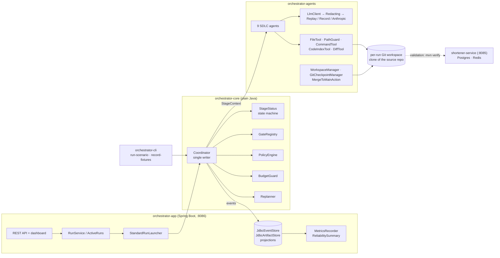
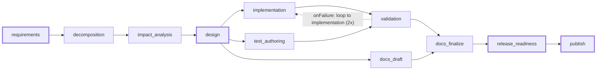
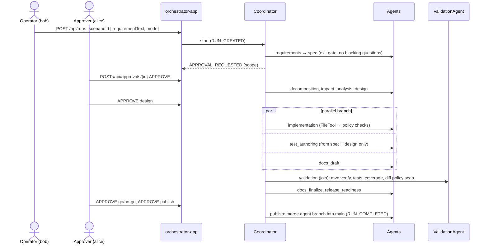
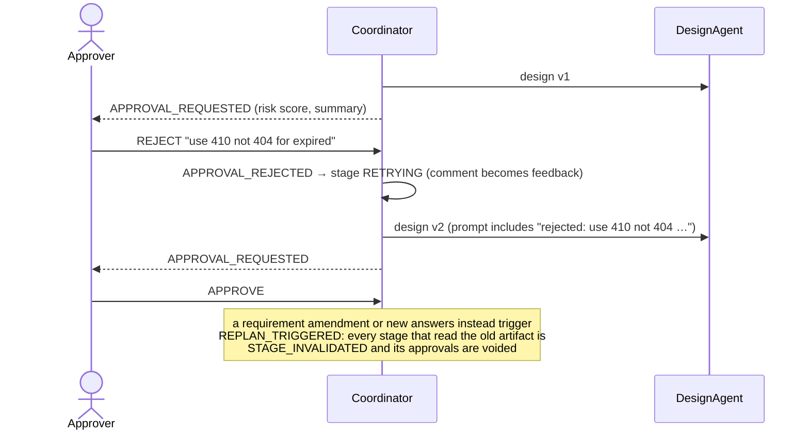
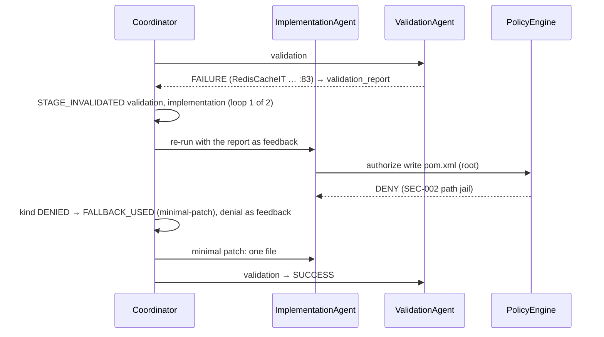
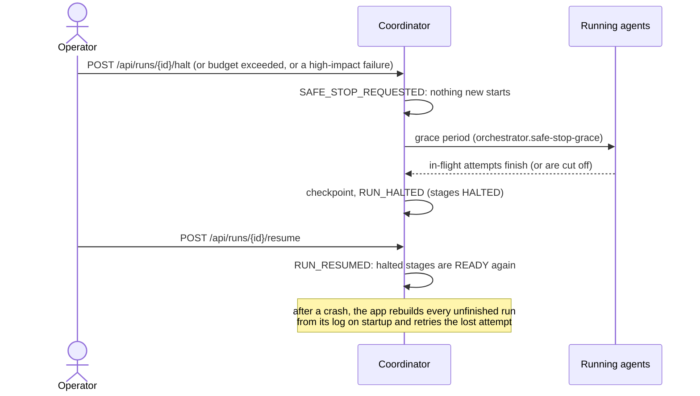

# Architecture

Two systems live in this repository:
- **The URL shortener** (`shortener-service`, port 8085) is the *target system*. It's a production
  Spring Boot service that the agents change.
- **The Agentic SDLC Orchestrator** (`orchestrator-*`, port 8086) runs a YAML-defined DAG of SDLC
  stages. Each stage is carried out by an agent: an LLM-backed one, or a deterministic one such as
  validation and publish. Gates, policies and human approvals sit at every step that matters.

## Components

| Module | Role | Depends on |
|---|---|---|
| `orchestrator-core` | Engine: workflow model and loader, DAG, coordinator, state machine, gates, policy engine, budgets, re-planner, event and artifact store ports and in-memory adapters | nothing (no Spring, Git or HTTP; enforced by ArchUnit) |
| `orchestrator-agents` | The agents, the LLM gateway, the tools (files, commands, Git, code index) | core's ports only (ArchUnit) |
| `orchestrator-app` | REST API with roles, Postgres stores, projections, recovery on startup, metrics, dashboard | core, agents |
| `orchestrator-cli` | `run-scenario` and `record-fixtures`: a run in one process with in-memory stores and scripted humans | core, agents |
| `shortener-service` | The target system | — |
| `coverage-report` | Aggregate JaCoCo report | all |

## Orchestration model
**The DAG** (`config/workflows/sdlc-standard.yml`):

Stages with a thick border need a human approval.
- **Skipping:** `impact_analysis` is skipped for GREENFIELD runs.
- **Fan-out (opt-in, `sdlc-fanout.yml`):** a stage marked `expand: tasks` is replaced, when it
  becomes ready, by one sub-stage per `CODE`/`CONFIG`/`MIGRATION` task of the task graph
  (`implementation.T1`, `implementation.T2`, …). The sub-stages are recorded as `STAGE_EXPANDED`, so a
  restarted coordinator rebuilds the same graph.
  - They keep the tasks' dependencies. Tasks whose `estimatedFiles` overlap are chained in task
    order, and the rest run in parallel.
  - Each sub-stage is a full stage, with its own attempts, retries, fallback, checkpoint and
    approval.
  - A failed attempt restores only the files it wrote (`CheckpointManager.restorePaths`), because
    the other sub-stages share the workspace.
  - A write to a file another task is writing, or wrote after this attempt started, fails the
    attempt as a validation error, and the attempt is retried (`WriteClaims`).
  - A loop-back to the stage re-runs every task. A new task graph re-expands the stage.
  - A task graph with no code tasks runs the stage once, unexpanded.

  The default `sdlc-standard.yml` runs `implementation` once over all tasks. The recorded scenarios
  use it.
- **Joins:** `validation` and `docs_finalize` wait for all their inputs.
- **High impact:** `publish` halts the run, instead of failing it, if it fails.

Each stage declares the following, and the workflow defaults fill in what it leaves out:
- its agent, `dependsOn`, and entry and exit gates;
- `retry` (full-jitter backoff), `timeout`, `fallback` (e.g. `minimal-patch`), `onFailure`
  (loop-back) and `approval`;
- `checkpoint: git`.

The run also has budgets: wall clock, LLM calls and tokens.

**The coordinator** (ADR-0006) is one thread per run. It consumes commands, evaluates gates and
policies, dispatches ready stages to agents on virtual threads, and appends every decision as an
event (ADR-0007). Agents see the run only through `StageContext`:
- typed input artifacts, recorded as lineage;
- `authorize(action)`, so the policy engine checks every write, command and diff, and the check is
  audited;
- budget accounting before and after each LLM call;
- the tools.

**Stage state machine.** 11 statuses: `PENDING`, `READY`, `RUNNING`, `WAITING_APPROVAL`,
`SUCCEEDED`, `FAILED`, `RETRYING`, `SKIPPED`, `INVALIDATED`, `ROLLED_BACK`, `HALTED`. They are
connected by 38 legal transitions. Anything else throws.

**Run statuses:** `CREATED`, `RUNNING`, `AWAITING_HUMAN` (something waits for a human and nothing is
runnable), `COMPLETED`, `FAILED`, `HALTED`, `ROLLED_BACK`.

**Failure handling**, in order:
1. A validation failure of a stage with `onFailure` loops back, with the report as feedback.
2. A transient or validation failure is retried after a backoff while attempts remain.
3. A policy **DENY** is never retried as it was. It goes straight to the stage's fallback, with the
   denial as feedback.
4. The fallback runs once.
5. If all of that fails, the stage fails, which fails the run, or halts it for a high-impact stage.
   A failed attempt that wrote files is restored to its checkpoint first.

## Control flows

### Normal run

### Approval rejected, then re-planned

### Validation failure, loop-back

### Safe stop and resume

## Data model
**Orchestrator** (Postgres, `orchestrator-app/src/main/resources/db/migration/V1__orchestrator_schema.sql`):

| Table | Holds |
|---|---|
| `workflow_event` | The log: `(run_id, seq)`, type, stage, actor, canonical payload, timestamp, `prev_hash`, `hash`. Triggers reject `UPDATE`, `DELETE` and `TRUNCATE`. |
| `artifact` | Versioned, immutable artifacts: `run:stage:type:vN`, content (JSON), content hash, inputs (lineage), producer, model, prompt hash, rationale |
| `run` | Projection: workflow, scenario, mode, autonomy, status |
| `stage_instance` | Projection: status, attempt, loop, timings per stage |
| `approval` | Projection: pending, granted and rejected approvals, with reason, summary, decider and comment |

Artifact types: `requirement`, `requirements_spec`, `answers`, `task_graph`, `impact_report`,
`design_doc`, `patch`, `test_patch`, `docs`, `validation_report`, `release_report`,
`publish_record`. The structured ones have JSON Schemas in
`orchestrator-agents/src/main/resources/schemas/`.

**Shortener** (Postgres): `link` (Feistel-coded ids, aliases, soft-deleted status),
`idempotency_record` (keyed by `sha256(api key name : Idempotency-Key)`), `click_event` and
`click_daily` (asynchronous analytics). Redis holds the L2 link cache and the rate-limit buckets.

## Key decisions
| ADR | Decision |
|---|---|
| [0001](adr/0001-code-generation.md) | Short codes from a sequence, a keyed Feistel permutation and Base62 |
| [0002](adr/0002-redirect-302.md) | Redirect with 302, not 301 |
| [0003](adr/0003-cache-strategy.md) | Two-level cache with negative caching and a Redis circuit breaker |
| [0004](adr/0004-analytics-at-most-once.md) | Click analytics are asynchronous, batched and at-most-once |
| [0005](adr/0005-custom-orchestrator-vs-framework.md) | A custom orchestrator in plain Java, not a framework or workflow engine |
| [0006](adr/0006-single-writer-coordinator.md) | One coordinator thread owns all run state |
| [0007](adr/0007-event-sourced-audit.md) | The append-only, hash-chained event log is the source of truth |
| [0008](adr/0008-record-replay-llm.md) | LLM calls are recorded and replayed by request hash |
| [0009](adr/0009-deterministic-validation.md) | Every pass/fail decision is deterministic code |

The reasoning behind each is in `docs/plan/DESIGN_RATIONALE.md`. The algorithms, data structures,
concurrency, failure modes and scaling are covered in depth in
[technical-deep-dive.md](technical-deep-dive.md). Security is in `docs/security.md`
and testing in `docs/testing.md`.
