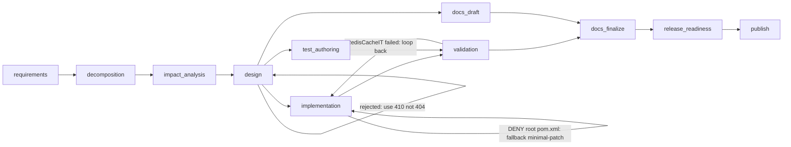

# Scenario 7.2: brownfield link expiry and the BF-1 fix

> "Links should support an optional expiry (`expiresAt` or `ttlSeconds`). Expired links return 410
> Gone. Also, users report deleted links still redirect for a while — fix it."

## Run it
From the repository root (Docker Desktop running):
```
.\mvnw.cmd -q install -DskipTests
.\mvnw.cmd -q -pl orchestrator-cli exec:java "-Dexec.args=run-scenario brownfield-expiry-bf1"
```
It replays `scenarios/brownfield-expiry-bf1/replay/` (no API key). Git, policies, the scripted
approver and the shortener's Maven build with Testcontainers are all real. The shortener is built
twice: once failing, once passing. The run ends `COMPLETED` in about 5 minutes, and its event log is
`.orchestrator/scenarios/brownfield-expiry-bf1/events.jsonl`.

## What the orchestrator did


| Stage | What happened | Human checkpoint / policy |
|---|---|---|
| requirements | 5 FR, 3 NFR, 8 acceptance criteria; classified BROWNFIELD | scope sign-off |
| decomposition | 7 tasks, 2 high risk (the migration, the create API) | — |
| impact_analysis | 11 files in 1 module, migration V3, risk notes on caching, rolling deploys and eviction order, and **2 tests to update** (the ones that pin BF-1) | — |
| design v1 | expired links answer 404, like deleted ones | **rejected**: "use 410 not 404 for expired" |
| design v2 | 410 `link-expired`; the comment reached the agent as feedback | approved |
| implementation ‖ tests ‖ docs | the implementation writes migration V3; the test agent receives the two BF-1 tests and rewrites them as regression tests, plus a new `LinkExpiryIT` | **CHG-001** (schema migration) needs approval |
| validation #1 | **fails**: the existing `RedisCacheIT.createWritesRedisWithTtl` expects `U:<url>` but gets `E:0:<url>` | loops back to implementation, with the build errors as feedback |
| implementation (loop-back) | tries to exclude `RedisCacheIT` in the root `pom.xml` | **DENY** (SEC-002 path jail) → straight to the fallback, never retried as is |
| implementation (minimal-patch) | one file: `RedisLinkCache` keeps `U:<url>` for links without an expiry | — |
| validation #2 | build succeeded, **276 tests green, line coverage 95 %** | CHG-001 on the whole diff (19 files) |
| docs_finalize, release_readiness | the numbers above; 2 open issues stated plainly | go / no-go |
| publish | merged into the run's `main` | approved before the merge runs |

**The fix:**
- Flyway V3 adds a nullable `link.expires_at`.
- Create accepts `expiresAt` or `ttlSeconds`, and rejects anything else with `400 invalid-expiry`.
- `CacheEntry.Found` carries the expiry, and every hit is checked. A redirect past the expiry
  answers `410 link-expired` from L1, Redis or the database.
- Redis keeps an expiring link only until its expiry.
- **BF-1:** delete evicts L1 and L2 after the transaction commits. `LinkServiceTest.deleteEvictsTheCachedLink`
  and `LinkApiIT.deletedLinkStopsRedirectingAtOnce` are the regression tests.

## Engine and agent changes this scenario needed
| Gap | Change |
|---|---|
| A policy DENY failed the stage outright, so the plan's DENY → fallback could not happen | New failure kind `DENIED`: never retried as is; the stage's fallback gets one try with the denial as feedback; a stage without one (or a denied fallback) fails |
| The impact report's `testsToUpdate` was never used, so a brownfield fix could not update the tests that pin the old behaviour | The test agent receives the current content of those tests and must rewrite only what the spec changes |
| The failing build summary carried test timings (`Time elapsed: 7.6 s`) into the next prompt | Timings are stripped, so the loop-back's prompt, and its fixture, are the same on every run |
| Line coverage differed in the fourth digit between runs (background threads), so the final prompts never matched on replay | The report gives coverage to the percent; the build's JaCoCo check still enforces the exact 80 % per package. A replay miss now saves the request under `.orchestrator/scenarios/<id>/replay-missing/` for comparison |

## Where the fixtures came from
Hand-written with `record-fixtures` (no API credit left, see the 7.1 write-up). Two replies are
deliberately bad: `ImplementationAgent-1` (the incompatible Redis format) and
`ImplementationAgent-2` (the denied write to the root POM). The rest is the code that was built and
tested before it was used.

## Lessons
- **Existing tests are the brownfield safety net.** Nobody asked for Redis compatibility; an old
  test enforced it. The orchestrator's job is to make the agent fix the code, not the net.
- **Policies have to stop "make it green" shortcuts.** Excluding a failing test is the easiest way to
  pass a build. The path jail made that impossible, and the narrower fallback did the right thing.
- **A rejection is cheap before code exists.** The 404-vs-410 choice was settled at design approval,
  where it cost one re-run of one stage.
- **Remaining risk is stated, not hidden.** Other instances' L1 can serve a deleted link for up to
  5 minutes. The release report lists it, along with the stale `docs/known-issues.md` entry.
