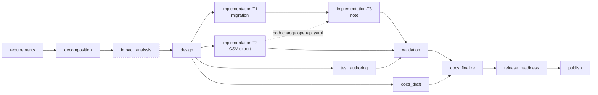

# Scenario: greenfield link notes and clicks CSV, fanned out per task

> "Links get an optional `note` (at most 280 characters) … Add `GET /api/v1/links/{code}/stats.csv`:
> the link's daily clicks as CSV."

This scenario runs the opt-in `sdlc-fanout` workflow (`workflow: sdlc-fanout` in `scenario.yml`).
The implementation runs as one sub-stage per code task, instead of one stage over all tasks.

## Run it
From the repository root (Docker Desktop running):
```
.\mvnw.cmd -q install -DskipTests
.\mvnw.cmd -q -pl orchestrator-cli exec:java "-Dexec.args=run-scenario greenfield-fanout-notes"
```
It replays `scenarios/greenfield-fanout-notes/replay/`, so it needs no API key. It ends `COMPLETED`
with 115 events, in about 2 minutes. It also runs in `ScenariosE2E` (`-Pe2e`), but not in the CLI
demo, which keeps the three Phase 7 scenarios.

## What the orchestrator did


The decomposition has five tasks. Only the three code tasks become sub-stages (`STAGE_EXPANDED`).
The TEST task is the test stage's work and the DOC task the docs stages'.

| Task | Files | How it ran |
|---|---|---|
| T1 (MIGRATION) | `V3__link_note.sql` | at once. Its write matched **CHG-001** (schema migration), so it waited for an approval |
| T2 (CODE) | `StatsCsv`, `StatsController`, `openapi.yaml` | **in parallel with T1**, and finished while T1 waited for its approval |
| T3 (CODE) | `Link`, `CreateLinkRequest`, `LinkResponse`, `LinkService`, `openapi.yaml` | after T1 (its declared dependency) **and** after T2 (they share `openapi.yaml`, so they were chained in task order) |

The rest of the run:
- **Validation:** `mvn -q -pl shortener-service -am verify` succeeded, with **278 tests green and
  95 % line coverage**. CHG-001 matched again on the whole diff (12 files, 467 lines), so the
  validation needed an approval too.
- **Approvals:** six in all, every one granted by the scripted approver: scope, architecture,
  T1's migration, the validated diff, go / no-go, and the merge before it runs.

`ScenariosE2E` checks the fan-out's shape from the event log:
- `implementation` itself never starts;
- T2 starts before T1 has succeeded;
- T3 starts only after both have succeeded.

## The change
- **Note:**
  - `CreateLinkRequest.note` uses `@Size(max = 280)`, so a longer note gets `400 validation-failed`;
  - `LinkService` stores it on generated and alias links through `Link.withNote`;
  - `LinkResponse` returns it;
  - the redirect path is unchanged, so the note never leaves the management API.
- **CSV:** `GET /api/v1/links/{code}/stats.csv` renders `StatsService.stats` as `day,clicks` rows.
  So the range rules, the errors and the owner check are exactly those of the JSON stats. It is
  served as the attachment `<code>-clicks.csv`.
- **Schema:** Flyway V3 adds the nullable `link.note`. It's a catalog-only change.

## Where the fixtures came from
The replies in `replies/` are hand-written with `record-fixtures`, like the other scenarios. The
code was built and tested against `phase-7` before it was used.

Each task of a fan-out is numbered on its own: `ImplementationAgent-T1-1.json`,
`ImplementationAgent-T2-1.json`, and so on. Parallel tasks call the model in a different order on
each run, so one shared count would hand a task another task's reply. The replay fixtures need no
such care, because they are keyed by the exact prompt, and each task's prompt names its task.

T3's reply writes `openapi.yaml` with T2's CSV path already in it, because T3 always runs after T2.
That is the point of chaining tasks that share a file: each one plans from the other's finished
file.
