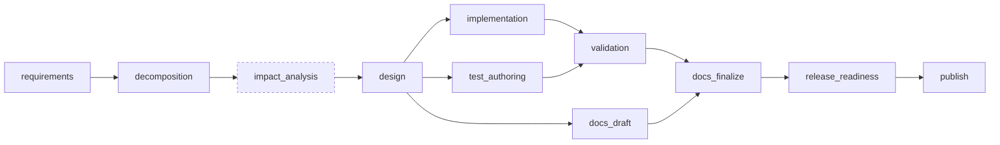

# Scenario 7.1: greenfield QR codes

> "Add an endpoint that returns a QR code PNG for a short link, with optional size (128–1024 px).
> It must respect link status."

## Run it
From the repository root (Docker Desktop running):
```
.\mvnw.cmd -q install -DskipTests
.\mvnw.cmd -q -pl orchestrator-cli exec:java "-Dexec.args=run-scenario greenfield-qr-code"
```
It replays the recorded fixtures in `scenarios/greenfield-qr-code/replay/`, so it needs no API key.
Everything else is real: Git workspaces, policy checks, approvals by a scripted approver, and the
shortener's full Maven build with Testcontainers. The run works on a bare copy of this repository
under `.orchestrator/scenarios/greenfield-qr-code/` and never touches the real `main`. It ends
`COMPLETED` in about 2 minutes, most of it the Maven build. The event log is written to
`events.jsonl` there.

## What the orchestrator did


| Stage | Result | Human checkpoint |
|---|---|---|
| requirements | 5 FR, 3 NFR, 10 acceptance criteria, 2 non-blocking ambiguities (public endpoint; encode the short URL) | scope sign-off |
| decomposition | 7 tasks, 1 high risk (the public endpoint) | — |
| impact_analysis | **skipped**: the run is GREENFIELD | — |
| design | 5 components, 3 risks, risk score 40; no schema change, no new config | architecture sign-off |
| implementation ‖ tests ‖ docs | ran in parallel from the approved design. Implementation wrote `shortener-service/pom.xml` (ZXing core 3.5.3) | **CHG-002**: the dependency change waited for approval |
| validation | `mvn -q -pl shortener-service -am verify`: build succeeded, **278 tests green, line coverage 95 %** (gate 80 %), no DENY | CHG-002 again on the whole diff (13 files, 443 lines) |
| docs_finalize | API note and ADR-0005 updated with the validated numbers | — |
| release_readiness | 7/7 checklist items done; 1 open issue stated plainly (BF-1) | go / no-go |
| publish | merged `agent/scn-greenfield-qr-code` into the run's `main` | approved **before** the merge runs |

The change itself: a `qr` feature package with `GET /{code}/qr?size=` (public and rate limited like
the redirect). It serves only `ACTIVE` links, checked in the database rather than the redirect
cache, so a deleted link gets `404` at once despite BF-1. Sizes outside 128–1024 get `400
/problems/invalid-qr-size`, and the PNG encodes the short URL. See `docs/api/qr-code.md` and
`docs/adr/0005-qr-codes.md` in the merged result.

## Where the fixtures came from
The first recordings used the live model (`--llm record`). They found real orchestrator problems,
listed below, and then the API credit ran out. The fixtures in this folder were written by hand
with `record-fixtures`: each reply in `replies/<Agent>-<n>.json` answers the exact prompt the
agent rendered, and the code in it was built and tested before it was used. `manifest.json`
records the base commit. The fixtures stay valid while the prompts, schemas and the
shortener-service code at that commit stay the same.

## What the live attempts taught us (and what changed)
| Symptom in a live run | Cause | Fix |
|---|---|---|
| Implementation and tests failed, then the circuit breaker opened | A fixed 60 s HTTP timeout; a 32k-token reply takes minutes | Each call's timeout is 60 s plus time for its token limit at 40 tokens/s |
| Code in an invented `app.*` package; a write to the root `pom.xml` (DENY) | In GREENFIELD mode, no agent saw the existing code | Design, implementation and tests get the shortener's code map and `pom.xml` in every mode |
| Code and tests disagreed on a required property; the app context failed to start | Tests are written from the design only, and the design did not pin the config | The design must list every new property with a safe default; tests set only those; failing tests are the contract |
| Validation re-ran an identical failing build | A retry policy on a deterministic stage | Validation does not retry; it loops back to implementation at once |
| Implementation and tests hit the 5-minute stage timeout | Long replies | 15 min for implementation and tests, 10 min for docs; run budget 60 min and 1M tokens |
| Replay could not match the final docs and release prompts | The validation report carried the Maven log tail (timestamps, PIDs, paths) and had a random key order | Only `[ERROR]` lines (paths made relative) or "build succeeded", serialized as canonical JSON |

## Lessons
- **Gates and policies held under a real model.** Every bad output (a wrong package, a forbidden
  path, compile errors, a contract mismatch) was caught by a gate, a policy or the build, and
  nothing reached `main`.
- **Loop-back works, but it is only as good as the contract.** Two loop-backs fixed compile errors
  from the build report. A disagreement between code and tests could not be fixed while the design
  left the configuration open.
- **Context is part of the design.** A greenfield change still lands in an existing code base, so
  every agent that writes code needs to see it.
- **Determinism is a feature.** Anything that reaches a prompt must be stable, or replay (and so
  the demo and the tests) breaks.
