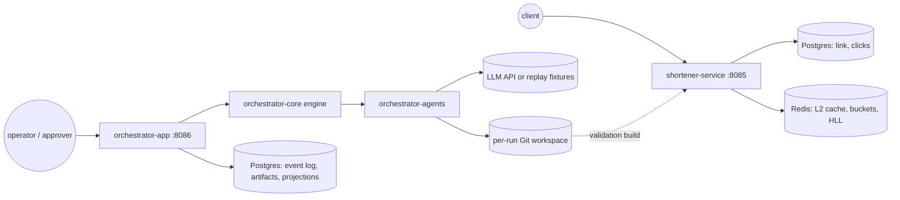
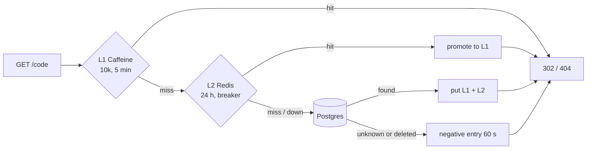
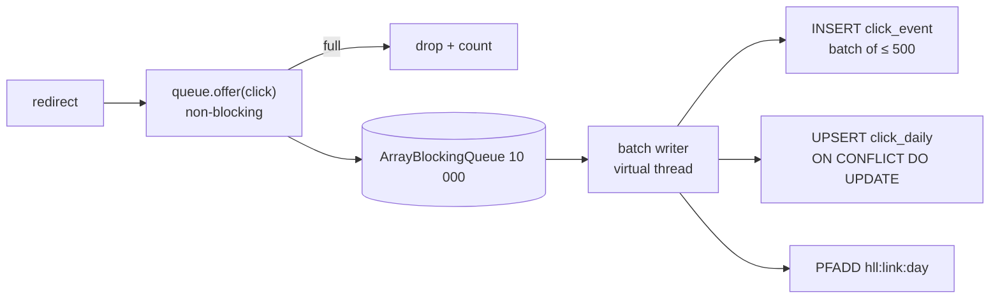
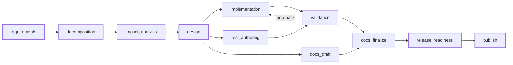
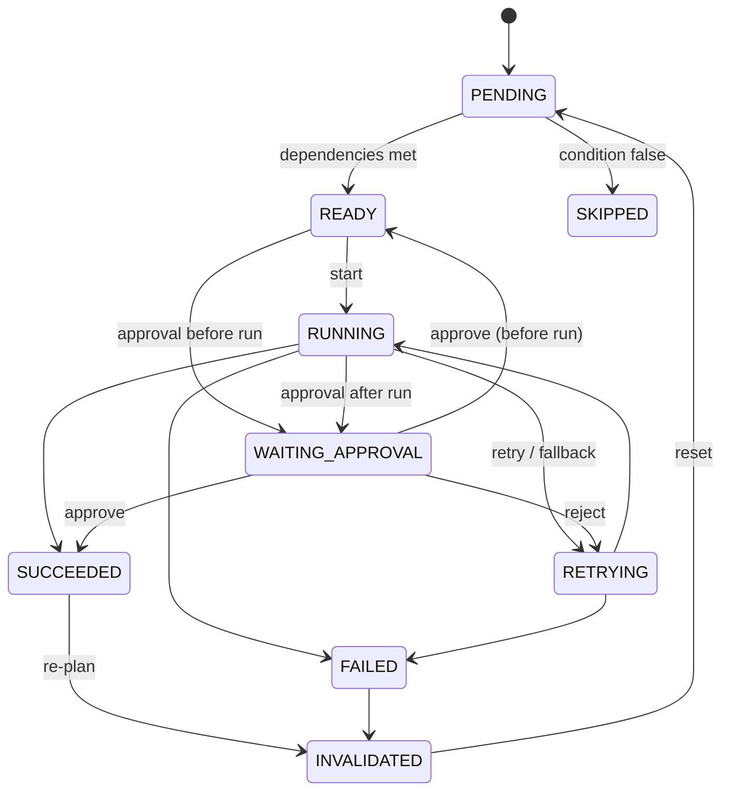

# Technical deep dive

This document explains the whole system: what it has to do, how it is designed, the algorithms and
data structures it uses and why, how requests and runs flow through it, what it costs, where it
breaks, and how it would scale.

Every class name, default and number below comes from the code or from measured runs. Estimates
are marked as such.

**Contents**
1. [The problem](#1-the-problem)
2. [System overview](#2-system-overview)
3. [The URL shortener](#3-the-url-shortener)
4. [The orchestrator](#4-the-orchestrator)
5. [Algorithms and data structures](#5-algorithms-and-data-structures)
6. [Concurrency model](#6-concurrency-model)
7. [Walkthroughs](#7-walkthroughs)
8. [Failure modes](#8-failure-modes)
9. [Scaling](#9-scaling)
10. [Trade-offs and alternatives](#10-trade-offs-and-alternatives)
11. [Complexity summary](#11-complexity-summary)

---

## 1. The problem
**Build an agentic SDLC orchestrator.** It takes a requirement through every lifecycle stage
(specification, planning, impact analysis, design, implementation, tests, docs, validation, release,
publish), with LLM agents doing the work. And it must govern them:
- **gates** decide whether work may continue;
- **policies** decide what an agent may do;
- **humans** approve at the points that matter;
- failures are **retried, looped back, fallen back or rolled back**;
- the run can be **safely stopped** and **re-planned** when the requirement changes;
- everything is **audited** in a form that can't be quietly edited.

**And build a real target system for it to change:** a production-quality URL shortener. Agents
must meet real constraints in it: a cache that must stay consistent, migrations, API contracts, and
existing tests.

| Requirement | Where it is met |
|---|---|
| Lifecycle stages as a governed workflow | YAML DAG (`config/workflows/sdlc-standard.yml`), `Coordinator`, `StageStateMachine` |
| Parallel work and joins | DAG edges; `Dag.readyNodes`; `implementation`, `test_authoring` and `docs_draft` run in parallel |
| Gates | `GateRegistry` / `StandardGates`: deterministic code |
| Policies and autonomy | `PolicyEngine` over `policies.yml` and `autonomy.yml`, plus invariants in code |
| Human approvals | stage `approval`, policy `REQUIRE_APPROVAL`, approver-only decisions |
| Failure handling | `FailureKind`, `RetryPolicy` (full jitter), fallback, `onFailure` loop-back, checkpoints |
| Safe stop, recovery | `SAFE_STOP_REQUESTED` → grace → `RUN_HALTED`; recovery replays the log |
| Re-planning | `Replanner`: answers, amendments, rejections, changed artifacts |
| Audit | an append-only, SHA-256 hash-chained event log with artifact lineage |
| Reproducibility | LLM record/replay by request hash |
| Safety of agent actions | path jail, command allowlist, secret and PII scans, review and sandbox for model-written code |

The shortener's own requirements: short, non-guessable, collision-free codes; fast redirects
(p99 in single-digit ms at the service); creation safe to retry; abuse limits; analytics that never
slow a redirect; graceful degradation when Redis fails.

## 2. System overview


| Module | Kind | Responsibility |
|---|---|---|
| `shortener-service` | Spring Boot | the target system |
| `orchestrator-core` | plain Java, no frameworks | the engine and its ports |
| `orchestrator-agents` | plain Java | agents, LLM gateway, tools (files, commands, Git, code index, sandbox) |
| `orchestrator-app` | Spring Boot | REST API, Postgres adapters, recovery, metrics, dashboard |
| `orchestrator-cli` | plain Java | run scenarios in-process, record fixtures, demo |

The boundaries are hexagonal and enforced by ArchUnit: core depends on nothing, and agents use only
core's ports. The engine can't accidentally grow a Spring dependency, and an agent can't write to the
event log behind the coordinator's back.

---

## 3. The URL shortener

### 3.1 API surface
- `POST /api/v1/links` (idempotent with `Idempotency-Key`);
- `GET` and `DELETE /api/v1/links/{code}`;
- `GET /api/v1/links/{code}/stats`;
- the public `GET /{code}` redirect.

Errors are RFC 9457 with stable type URIs. Details are in `docs/reference/api.md`.

### 3.2 Capacity (estimates, to size the design)
| | Assumption | Consequence |
|---|---|---|
| Links | 100 M over the service's life | `link` ≈ 100 M × ~300 B (incl. URL and index) ≈ **30 GB** |
| Redirects | 1 B / month ≈ 400/s average, **4 000/s peak** (10×) | reads dominate writes by about 100:1, so cache the read path |
| Creates | 10 M / month ≈ 4/s | the database handles it easily |
| Clicks | 1 B / month × ~100 B | ≈ **100 GB / month** raw: partition `click_event` monthly, keep aggregates |
| Hot set | ~1 M links | L2 ≈ 1 M × ~150 B ≈ **150 MB** of Redis; L1 holds 10 000 per instance |

Measured on one laptop: one instance served about **1 840 cached redirects/s** with 32 clients, and
**p99 4.8 ms** with one client, over HTTP including the Redis rate-limit round trip
(`docs/testing.md`). So about 3 instances cover the estimated peak with headroom.

### 3.3 Data model
```
link(id BIGINT PK  -- from link_id_seq, before insert
     code VARCHAR(32) UNIQUE, original_url TEXT, custom_alias BOOL,
     status ACTIVE|DELETED (CHECK), created_by, created_at, updated_at, version INT)
  UNIQUE INDEX ux_link_alias_lower ON link (lower(code)) WHERE custom_alias
idempotency_record(key PK = sha256(api key name ':' Idempotency-Key), api_key_name,
     request_hash, response_status, response_body JSONB, created_at)  + index on created_at
click_event(id BIGSERIAL, link_id FK, occurred_at, referrer_host, ua_family, visitor_hash CHAR(64))
  INDEX (link_id, occurred_at)
click_daily(link_id, day, clicks, PK (link_id, day))   -- upserted aggregates
```
Design notes:
- **Ids come from a sequence before the insert,** because the code is derived from the id
  (§5.1). Spring Data JDBC decides insert-or-update from `version` (`null` means new).
- **Case-insensitive alias uniqueness is a partial unique index.** It applies to aliases only,
  because generated Base62 codes need both cases. The database settles races between concurrent
  creates; the application check only gives a nicer error.
- **Deletion is soft** (`status`). The row stays for the owner and for analytics' foreign keys.
- **Pre-aggregated `click_daily`.** A 90-day stats query reads at most 90 rows, not every event.
- **Raw IPs are never stored.** `visitor_hash` is an HMAC that rotates daily (§5.5).

### 3.4 The read path: a two-level cache (ADR-0003)

- **L1** is per instance and in process, so a hit costs nanoseconds. **L2** (Redis) is shared, so a
  new or restarted instance warms quickly and a create is visible everywhere.
- **Negative caching.** Found and not-found entries live in separate L1 caches, so the short
  negative TTL (60 s) never shortens real entries. Scans for random codes then hit the cache, not
  Postgres.
- **The Redis circuit breaker.** Every Redis call runs through a Resilience4j breaker
  (count-based window of 20, at least 10 calls, 50 % failure rate, 10 s open, 3 half-open probes),
  and the client timeout is 200 ms. A slow or dead Redis costs DB load, never latency (§8).
- **Consistency:**
  - **On create,** the cache is written after the transaction commits, so a rolled-back create is
    never cached.
  - **On delete,** on `main`, the cache is **not** evicted. That's the seeded defect BF-1: the link
    keeps redirecting until its L1 and L2 entries expire.
  - **The 7.2 fix** evicts L1 and L2 after commit. It leaves one window: other instances' L1, up to
    5 minutes. Closing that needs Redis pub/sub invalidation.

### 3.5 Creating a link
1. **Validate the URL** (`UrlValidator`):
   - length, scheme allowlist, no user info, a host, not this service's host;
   - numeric IPs must be in canonical dotted-quad form, which defeats `0x7f.1` and `2130706433`
     spellings of loopback;
   - DNS resolution within 500 ms (fail closed), refusing private, loopback, link-local and
     multicast addresses.

   This is defence in depth: the service never fetches destinations, but a future preview feature
   might.
2. **Choose a code:** an alias (validated, unique case-insensitively), or `nextval → Feistel →
   Base62` (§5.1). A generated code that equals an existing alias is skipped by taking the next id.
   It's checked before insert, because a failed INSERT would abort the surrounding transaction.
3. **Insert.** After commit, write the cache.
4. **Idempotency** (§5.8) wraps all of this when `Idempotency-Key` is sent.

### 3.6 Rate limiting
- **The algorithm:** a token bucket per `(scope, subject)` (§5.3). Creation is keyed by API key name
  (60 burst, 1/s). Redirects are keyed by visitor fingerprint (600 burst, 10/s).
- **Atomic in Redis:** a Lua script does the bucket update, so instances share limits without locks
  or races.
- **Without Redis,** the policy depends on the scope:
  - **creation** falls back to a per-instance bucket, bounded by Caffeine to 10 000 keys, so an
    abusive client still can't flood;
  - **redirects** fail open (`UNMETERED`), because availability matters more there.
- **Headers:** `RateLimit-*` (IETF draft) and `Retry-After` on a 429.

### 3.7 Analytics (ADR-0004)

- **At-most-once, by choice.** A redirect never waits for analytics. Losing clicks under overload,
  or in a crash, is acceptable; slowing redirects is not (assumption A-4).
- **The batch writer** drains up to 500 events, or whatever arrived within 1 s, so database round
  trips drop by the batch size. On graceful shutdown it stops after the web server and flushes what
  is left.
- **Unique visitors:**
  - **Redis HyperLogLogs,** one per link per UTC day: about 12 KB, about 0.81 % error (§5.4). A
    range is `PFCOUNT` over the day keys, which counts their union.
  - **Without Redis,** the count comes exactly from `click_event`.

### 3.8 Security
SSRF defences (§3.5), constant-time API-key comparison, ownership checks that answer 404 instead
of 403 (no existence oracle), RFC 9457 errors without internals, security headers (CSP, HSTS,
`nosniff`, `X-Frame-Options: DENY`), and no raw IPs in logs or the database. The full review is in
`docs/security.md`.

---

## 4. The orchestrator

### 4.1 The workflow

Thick borders are human approvals.
- **Skipping:** `impact_analysis` has the condition `run.mode == 'BROWNFIELD'`; otherwise it is
  `SKIPPED`, which satisfies its dependents.
- **Approve before run:** `publish` is a deterministic action (`git.mergeToMain`), approved
  *before* it runs, and `highImpact`.
- **Independent tests:** `test_authoring` sees the spec and the design, never the implementation,
  so the tests check what was asked, not what was built.

### 4.2 The engine: a single-writer coordinator (ADR-0006)
One platform thread per run (`coordinator-<runId>`) takes `Command`s from a `LinkedBlockingQueue`
and is the only code that changes the run. Commands are human decisions, `StageCompleted` and
`StageFailed` from workers, timer firings, amendments and halts.

Each pass:
1. **Readiness:** every `PENDING` stage whose dependencies are all `SUCCEEDED` or `SKIPPED` becomes
   `READY`. A false `condition` skips it instead.
2. **Entry gates** run.
3. **Checkpoint:** stages with `checkpoint: git` get one.
4. **Dispatch:** the stage goes to a virtual thread with a `StageContext`.

When a worker finishes, it sends a command back. The coordinator then:
- stores the artifacts;
- evaluates the exit gates and the attempt's policy checks;
- moves the stage to `SUCCEEDED`, `WAITING_APPROVAL` or a failure path.

Joins need no special code: a stage is ready only when all its dependencies are.

**State comes from the log.** It is re-projected after each event (`RunStateProjector`), so what the
coordinator acts on is exactly what crash recovery would rebuild. Results that arrive for an attempt
that is no longer current are dropped: each dispatch has a sequence number, so a late result from
an attempt that was halted or invalidated changes nothing.

### 4.3 The stage state machine
11 statuses and 38 legal transitions in one table (`StageStateMachine`). Anything else throws
`IllegalTransitionException`: an engine bug becomes an exception, never a silently corrupt run.


Also: `HALT` from every unfinished status leads to `HALTED`, which resets to `PENDING` on resume;
`ROLL_BACK` from every started status leads to `ROLLED_BACK`, which resets to `PENDING`; and
`READY → FAILED` on an entry gate.

**Run statuses:** `CREATED`, `RUNNING`, `AWAITING_HUMAN` (something waits for a human *and* nothing is
runnable), `COMPLETED`, `FAILED`, `HALTED`, `ROLLED_BACK`.

### 4.4 Failure handling
| Kind | From | Response |
|---|---|---|
| `TRANSIENT` | timeouts, I/O, LLM unavailable | retry with full-jitter backoff, then the fallback |
| `VALIDATION` | exit gates, an invalid reply | loop back (`onFailure`) while loops remain, else retry, else fallback |
| `DENIED` | a policy DENY in the attempt | never retried as it was: straight to the fallback, with the denial as feedback |
| `FATAL` | illegal input or state; a rejection before the stage runs | fail |
| `BUDGET` | call, token or time budget exhausted | safe stop |

- **Clean retries:** an attempt that wrote files is restored to its checkpoint before the next one
  starts.
- **High-impact stages:** a `highImpact` stage that fails halts the run for a human instead of
  failing it.

Scenario 7.2 shows the whole chain:
1. validation fails and loops back with the `[ERROR]` lines as feedback;
2. the re-run tries to exclude the failing test in the root POM, which SEC-002 denies;
3. the `minimal-patch` fallback fixes one file;
4. validation passes.

### 4.5 Governance
- **Gates** (§ reference) are deterministic. The LLM proposes; code decides.
- **Policies.** Every action an agent takes goes through `StageContext.authorize`: file writes,
  commands, and the final diff, judged again at validation. The engine reports every matching rule,
  and the effect is the strictest. The autonomy level can only tighten.
- **Invariants live in code,** not in the YAML:
  - publish needs a human;
  - a DENY can never be overridden;
  - only a human approver counts.
- **Unreviewed model output:**
  - CHG-005 makes any write of it under `shortener-service/**` need approval;
  - validation builds it in the Docker sandbox (§4.9).

### 4.6 Event sourcing and audit (ADR-0007)
- **25 event types.** Each event is `(runId, seq, type, stageId?, actor, payload, timestamp,
  prevHash, hash)`.
- **The hash:** `hash = SHA-256(prevHash ‖ canonicalJson(event without hash))`, with
  `GENESIS = 64 zeros`.
- **The Postgres adapter (`JdbcEventStore`):** each append is one transaction. It takes a per-run
  advisory lock, reads the head, inserts `seq = head + 1` with `prevHash = head.hash`, and rewrites
  the projections (`run`, `stage_instance`, `approval`). `UNIQUE (run_id, seq)` backs it up.
- **Append-only:** triggers reject `UPDATE`, `DELETE` and `TRUNCATE` on `workflow_event`.
- **Verification:** `AuditVerifier` recomputes the chain and names the first broken `seq`. It
  detects altered, removed, inserted and reordered events, but not events cut off the end; that
  needs the head hash anchored outside the database.
- **Artifacts and lineage:** artifacts are immutable and versioned (`run:stage:type:vN`). Each
  records its inputs, producer, model and prompt hash, so lineage is a graph query
  (`/api/artifacts/{id}/lineage`).

### 4.7 Re-planning
`Replanner` is pure: it decides what a change invalidates, and the coordinator applies it.
1. **Answers to blocking questions** re-run the requirements stage.
2. **An amended requirement** re-runs every stage that read the requirement, and everything
   downstream of them.
3. **A rejection** re-runs the stage with the comment as feedback.
4. **A re-run that changed an artifact's content** invalidates the stages that consumed the old
   version.

Approvals of invalidated stages are **voided**: they approved a different scope. Scenario 7.3 shows
it: the amendment invalidates 7 stages, and the pending implementation approval disappears.

### 4.8 The LLM layer
```
agent → LlmClient (schema validation, one repair) → RedactingLlmGateway → Replay | Recording(Scripted|Anthropic)
```
- **Prompts:** templates `prompts/<Agent>.md` with `{{placeholders}}`. A placeholder without a value
  is an error, because a silently empty section looks like a bad model answer.
- **Structured replies:**
  - every reply must validate against `schemas/<type>.json` (JSON Schema 2020-12, networknt);
  - an invalid reply gets one repair attempt, with the validation errors appended;
  - there is no free-text channel into actions.
- **Redaction:** the values of secret-looking environment variables, plus known key formats, are
  replaced before anything leaves the process. So fixtures are redacted too.
- **Live calls** (`AnthropicLlmGateway`):
  - timeouts scale with the token limit: 60 s plus the limit at 40 tokens/s;
  - Resilience4j retry and a circuit breaker;
  - one optional fallback model;
  - `maxRetries(0)` in the SDK, so retries happen in exactly one place.
- **Record and replay** (ADR-0008): §5.10.

### 4.9 Tools and the sandbox
- **`FileTool` / `PathGuard`:** every path is resolved inside the workspace. Absolute paths, drive
  letters, `~` and escaping `..` are refused, and symlinks are resolved. Every write is
  policy-checked first.
- **`CommandTool`:** an exact-match allowlist (CMD-001), no shell (the line is split on whitespace),
  a timeout, the whole process tree killed, secret variables removed, and the output capped (first
  and last 100 000 characters).
- **`DockerSandbox`,** for validation of unreviewed code:
  - a private `docker:dind` daemon on a network of its own;
  - the build in `eclipse-temurin:21` with only the workspace and a Maven cache mounted, four
    environment variables, all capabilities dropped, `no-new-privileges`, and CPU, memory and
    process limits;
  - all of it removed afterwards.

  The private daemon gives the shortener's Testcontainers tests a Docker to use without exposing
  the host's Docker, which would amount to root.
- **Git** (JGit):
  - **workspaces:** one clone per run (`agent/<runId>` branch), with `core.autocrlf=false` so line
    endings, and therefore prompts, are the same on every OS;
  - **checkpoints:** commits also kept as `refs/orch/<run>/<label>`; restoring is a hard reset plus
    removing untracked files;
  - **publish:** merges the latest base into the run's branch, so `main` can only fast-forward,
    then pushes to a bare origin.
- **`CodeIndexTool`:** a regex map of the Java module (packages, public types and methods, REST
  mappings, migrations), small enough for a prompt, so agents see the codebase they change.

---

## 5. Algorithms and data structures

### 5.1 Short codes: Feistel permutation + Base62 (ADR-0001)
**The problem:** codes must be short (7 characters), collision-free forever, cheap, and not
enumerable. Knowing one code must not reveal its neighbours or the link volume.

**The construction:** `code = Base62(Feistel_k(id), 7)`, where `id` comes from a Postgres sequence.
- **The domain** is the code space: `N = 62⁷ = 3 521 614 606 208`, about 2^41.68.
- **A balanced Feistel network over 2·h bits:** `bits = ⌈log₂ N⌉ = 42`, so `h = 21` and the block is
  2^42. Each of 4 rounds is `(L, R) → (R, L ⊕ F(round, R))`, with `F` the first 21 bits of
  `HMAC-SHA256(secret, round ‖ R)`. The network is a bijection on 2^42 whatever `F` is, because each
  round is invertible: `L = R' ⊕ F(R)`.
- **Cycle-walking:** 2^42 > N, so an output ≥ N is encrypted again until it lands in `[0, N)`. That
  keeps a bijection on the subset, because the walk can't loop forever and two inputs can't meet.
  The expected number of encryptions is `2^42 / N ≈ 1.25`.
- **Luby–Rackoff:** with a pseudorandom `F`, 4 rounds give a strong pseudorandom permutation.
  Neighbouring ids map to unrelated codes.
- **Base62** (`0-9a-zA-Z`), fixed length with left zero padding. Encoding and decoding take
  `O(length)`.

**Properties:** no collisions by construction, so no retry loop; O(1) per code, with about 1.25 × 4
HMACs; deterministic for a given secret. Compare a random 7-character code: the birthday bound
reaches a 50 % collision chance at about √(2N ln 2) ≈ 2.2 million links, so it needs a uniqueness
check and a retry.

**Not encryption:** codes are scrambled ids, not access control. The secret prevents enumeration;
the API still checks ownership.

### 5.2 Caffeine (L1 cache and the local rate-limit buckets)
- **Eviction is W-TinyLFU:** a small LRU admission window in front of a segmented-LRU main space.
  A count-min sketch of recent access frequency (with periodic halving, for ageing) decides whether
  a newcomer may displace a victim. Its hit rate is near-optimal for skewed traffic like redirects.
- **Cost:** O(1) amortised per operation. The sketch costs a few bytes per entry.
- **Use here:** bounded (`maximumSize`) with `expireAfterWrite`. Found and not-found entries have
  separate caches, so they can have separate TTLs. The local rate limiter uses one too, so unique
  keys can't grow memory without limit.

### 5.3 Token bucket (rate limiting)
**State:** `(tokens, ts)` per key. **Check at time `now`:**
```
if now > ts:  tokens = min(capacity, tokens + (now − ts) × rate);  ts = now
allowed = tokens ≥ 1;  if allowed: tokens −= 1
```
- **Cost:** O(1) time and two numbers of state.
- **Shape:** it allows bursts up to `capacity` and averages `rate` over time, which is better for
  people than a fixed window's edge effects. It never refills on an older timestamp, so instances
  with slightly different clocks can't add tokens.
- **Redis version** (`token-bucket.lua`): `HMGET`, compute, `HSET`, `PEXPIRE` run atomically on the
  server (Lua scripts are atomic). That makes it race-free across instances in one round trip. The
  key TTL lets idle buckets disappear.
- **Java version** (`TokenBucket`, for the local fallback): the same algorithm. The two are kept in
  step.

### 5.4 HyperLogLog (unique visitors)
- **The idea:** each element is hashed. The hash's first `p` bits choose one of `m = 2^p` registers,
  and the register keeps the longest run of leading zeros seen in the rest. The harmonic mean of
  `2^register` over the registers, scaled, estimates the cardinality.
- **In Redis:** `p = 14`, so m = 16 384 registers of 6 bits: **12 KB per key**. The standard error
  is `1.04 / √m ≈ 0.81 %`.
- **Union is free:** HLLs merge by taking the register-wise maximum, so `PFCOUNT k1 k2 …` counts
  distinct visitors over a range of days without storing any visitor.
- **Here:** one key per link per UTC day (`hll:<linkId>:<yyyyMMdd>`, TTL 400 days). A visitor seen on
  two days counts twice, because the fingerprint rotates daily (§5.5) and that's documented.

### 5.5 The visitor fingerprint
`HMAC-SHA256(key, "visitor\n" + utcDay + "\n" + ip + "\n" + userAgent)`, keyed with the code secret.
- **Every instance agrees:** it's deterministic per day, so all instances compute the same hash for
  the same visitor.
- **It can't be reversed or linked:** the hash isn't reversible to an IP without the key, and the
  daily rotation unlinks one day's hashes from the next.
- **No raw IP is stored or logged.**

### 5.6 The bounded click queue
- **The queue:** an `ArrayBlockingQueue` of capacity 10 000. `offer` never blocks: a full queue
  drops the click and counts it. That bounded buffer is what makes "analytics never slows a
  redirect" true.
- **The writer:** drains with `drainTo`, up to 500 events or whatever arrived within 1 s.
- **The writes:** a JDBC batch insert of the events, and an upsert of the daily aggregates:
  `INSERT … ON CONFLICT (link_id, day) DO UPDATE SET clicks = clicks + EXCLUDED.clicks`.
- **Cost:** O(batch) per flush; database round trips are about N / 500.

### 5.7 Two caches in one interface: the sealed `CacheEntry`
`CacheEntry = Found(url) | NotFound` is a sealed interface, so `switch` over it is exhaustive.
- **In Redis:** one key per code, `link:<code>`, holding `U:<url>` or `N`. A create simply overwrites
  a negative entry.
- **Breaker semantics:** every Redis read and write runs through the breaker. Failures return an
  empty result, which counts as a miss.

### 5.8 Idempotency
`storageKey = sha256(apiKeyName ":" Idempotency-Key)`, so keys are scoped per client. In **one
transaction**:
1. delete the record if it is older than the TTL;
2. `tryClaim`: an insert that succeeds only if no record exists;
3. **if claimed:** run the create and store its response;
4. **if not claimed:** load the record; if `request_hash` differs, answer `422`; else replay the
   stored response with `Idempotent-Replayed: true`.

**Concurrent duplicates** block on the primary key until the first transaction commits, then replay
its response; Postgres serialises them. If the create fails, the claim rolls back with it and the
client can retry with the same key. Only successful responses are stored.

### 5.9 The workflow DAG
`Dag<T>` keeps adjacency lists in both directions (`out` and `in`), as `LinkedHashMap`s, so every
result has a deterministic order. Replays and tests depend on that.

| Operation | Algorithm | Cost |
|---|---|---|
| `topologicalOrder` | **Kahn's algorithm:** start with in-degree 0; take a node and decrement its dependents; ties go to insertion order | O(V + E) |
| cycle report | if Kahn emits fewer than V nodes: **DFS with an on-stack set** to name one cycle (`[a, b, c, a]`) | O(V + E) |
| `levels` | the topological order, with each node one level below its deepest dependency (parallel layers) | O(V + E) |
| `readyNodes` | the PENDING nodes whose dependencies all satisfy (`SUCCEEDED` / `SKIPPED`) | O(V + E) per scheduling pass |
| `downstreamClosure` / `upstreamClosure` | **BFS** | O(V + E) |
| `expand` | replace a node by a subgraph of tasks, keeping their internal dependencies and the node's outside edges (the fan-out, below) | O(V + E + tasks) |

V and E are tens, so recomputing on every pass is cheaper than maintaining incremental structures,
and simpler.

**Task fan-out** (`TaskExpansion`, opt-in through `sdlc-fanout.yml`). When a stage marked
`expand: tasks` becomes ready:
1. The coordinator plans one sub-stage per code task of the latest `task_graph`, with key
   `<stage>.<task>`. Stage ids can't contain a dot, so a key never clashes with a stage id.
2. It adds an edge from each task to every earlier task that shares an estimated file, unless the
   later task already reaches it. That is a pairwise check with a BFS reachability test:
   O(T² · (T + E)) for T tasks, and T is a handful.
3. It records `STAGE_EXPANDED`.
4. It rebuilds the run graph as `WorkflowGraph.of(workflow)` plus the latest expansion of each
   stage. Recovery and the dashboard rebuild the same graph from the log.

The tasks share one workspace, so there are two more rules:
- **Selective restore.** A failed attempt restores only the paths it wrote, taken from its
  `file_write` policy checks.
- **Write claims.** `WriteClaims` is a path → (task, logical tick, live) map. A write fails the
  attempt when another task holds the path, or wrote it after this attempt began. The retry then
  starts from the newer file, so no change is silently lost.

### 5.10 Record and replay: content-addressed fixtures
- **The key:** `requestHash = SHA-256(canonicalJson({agent, system, user, schema}))`. Each fixture is
  `replay/<requestHash>.json`, holding the redacted request and the reply.
- **Lookup** is O(1) by file name: a content-addressed store.
- **Every input counts:** any change to a prompt input (code, template, schema, answers) changes the
  hash, so a drift is a hard `ReplayMissingException`, never a silently wrong reply.
- **The cost is determinism.** Everything that reaches a prompt must be the same on every run.
  Fixing that meant:
  - feedback without run ids;
  - build summaries without timings or paths;
  - coverage to the percent;
  - canonical answers and reports;
  - scenarios pinned to a base commit.

### 5.11 Canonical JSON
- **One serialization** gets hashed (`CanonicalJson`): object keys sorted by UTF-16 code units (as
  RFC 8785), no whitespace, fixed escaping, and one form for numbers.
- **Normalised first:** values are mapped to a small JSON data model, so the same data gives the
  same bytes even after a database round trip.
- **Without it,** a hash chain would break whenever a map iterated in another order. That happened
  once: `Map.of` iteration order differs between JVM runs.

### 5.12 The hash chain
- **The structure** is a linked list of SHA-256 digests, the same structure as Git commits and
  certificate transparency logs.
- **Changing any event** changes its hash, and therefore the next event's `prevHash` check, and so
  on to the end. Tampering is evident in O(n) verification.
- **The limit:** it isn't tamper-proof against someone who can rewrite the whole chain. External
  anchoring of the head hash closes that.

### 5.13 Path globs
`Glob` compiles a pattern to an anchored regex, once:

| Glob | Regex |
|---|---|
| `**/` | `(?:[^/]+/)*` |
| `**` | `.*` |
| `*` | `[^/]*` |
| `?` | `[^/]` |
| anything else | quoted literally |

So `**/pom.xml` matches `pom.xml` and `a/b/pom.xml`, while `*` never crosses a `/`. Matching is
linear in the path length.

### 5.14 Full-jitter exponential backoff
`delay = random(0 … min(maxDelay, baseDelay × 2^(attempt−1)))`. The doubling is capped with a
`1 << min(n−1, 30)` shift, so it can't overflow.
- **Why random:** spreading retries uniformly avoids synchronised retry storms (the "thundering
  herd"), where every client retries at the same instant after an outage.
- **Why full jitter:** of the common jitter schemes, it does the least total work and spreads
  retries the most.
- **Testable:** the random generator is injected, so the tests can be deterministic.

### 5.15 Circuit breakers
Resilience4j's count-based **sliding window** is a ring buffer of the last N call outcomes.
- **Closed:** calls pass through. When the failure rate over the window crosses the threshold
  (with at least the minimum number of calls), the breaker opens.
- **Open:** calls are refused immediately for a wait duration.
- **Half-open:** a few probe calls decide whether it closes again or reopens.

Where they're used:
- **Redis** (shortener): window 20, 50 %, 10 s;
- **the LLM API:** window 10, 50 %, 30 s; only retryable errors count.

### 5.16 Policy evaluation
- **For one action:** every rule is checked. Matches are collected with their reasons; the effect
  is the maximum over `ALLOW < REQUIRE_APPROVAL < DENY`; the risk score is the sum of the matched
  weights plus a size factor, capped at 100.
- **For a diff:** `UnifiedDiff` parses it in one linear pass. It collects every touched path, old
  and new (so a delete counts), and every added line with its number in the new file. Path rules
  then apply to every path, and content patterns to every added line.
- **Cost:** O(rules × (paths + added lines × patterns)).

### 5.17 Secret redaction
Two layers, applied to every outgoing prompt:
1. the exact **values** of environment variables whose **names** look secret (`secret`, `password`,
   `token`, `api_key`, …), at least 8 characters long, whatever their shape;
2. **patterns:** private-key blocks, AWS access keys, `sk-ant-…`, GitHub tokens, bearer tokens, and
   `name = value` assignments.

It costs a linear scan per pattern.

---

## 6. Concurrency model
| Where | Model | Why |
|---|---|---|
| Shortener requests | **virtual threads** (`spring.threads.virtual.enabled`) | blocking JDBC and Redis code stays simple and scales to many concurrent requests; no reactive stack |
| Cache, rate limits | Caffeine (concurrent); Redis Lua (server-side atomic) | no application locks |
| Click pipeline | a lock-free hand-off through `ArrayBlockingQueue`; one writer virtual thread | the redirect path never blocks |
| Orchestrator run | **one platform thread** per run owns all state (actor / single writer) | deterministic event order, no races, no locks |
| Agents | a **virtual thread** per attempt; results go back as commands | parallel branches without shared mutable state |
| Event store | a per-run Postgres advisory lock in the append transaction | `seq` and `prevHash` come from the true head |
| Idempotency | Postgres primary-key conflicts serialise duplicates | correct across instances without distributed locks |

Shared state is either immutable (records, `List.copyOf`), confined to one thread (the coordinator's
maps), or owned by a store that serialises access (Postgres, Redis).

## 7. Walkthroughs

### 7.1 A redirect
1. `CorrelationIdFilter` assigns the request id, and `SecurityHeadersFilter` sets the headers.
2. `RateLimitInterceptor` computes the visitor fingerprint (HMAC) and runs `token-bucket.lua` on
   `rl:redirect:<hash>` through the breaker. A failure means fail open.
3. `RedirectController` calls `LinkService.resolve(code)`, which tries L1, then L2 (breaker), then
   `findByCode`, and caches the answer (found 24 h in L2 and 5 min in L1, or not-found 60 s).
4. It answers `302` with `Location` and `Cache-Control: max-age=0, private`, then calls
   `clicks.publish(…)`, a non-blocking `offer`.
5. Later, the writer batches the click into `click_event`, upserts `click_daily`, and `PFADD`s the
   day's HyperLogLog.

On a hot path with an L1 hit, the costs are one HMAC, one Redis round trip (the rate limit), and a
map lookup.

### 7.2 An orchestrator run
1. **`POST /api/runs`:** `RunService` registers the run and stores the requirement artifact.
   `StandardRunLauncher` then:
   - clones the source repository into a workspace on branch `agent/<runId>`;
   - builds the agents and the gateway (replay, record or live; sandbox `auto`);
   - starts the `Coordinator`, which appends `RUN_CREATED` with the policy hashes.
2. **Each stage:**
   1. `STAGE_READY`; entry gates (`GATE_EVALUATED`); a checkpoint (`CHECKPOINT_CREATED`);
      `STAGE_STARTED`.
   2. The agent runs on a virtual thread. It reads its typed inputs (lineage), renders its prompt,
      and calls the gateway: redaction, then replay by hash or a live call with schema validation
      and one repair. That records `AGENT_INVOKED` and `USAGE_RECORDED`.
   3. File writes go through `FileTool`, each one policy-checked (`POLICY_EVALUATED`).
   4. The result returns as a command. The coordinator stores the artifacts (`ARTIFACT_PRODUCED`)
      and evaluates the exit gates. The stage then succeeds, waits for approval, or goes down the
      failure path.
3. **Validation:** `ValidationAgent` runs the allowlisted Maven command in the workspace, in the
   sandbox when the code is unreviewed. It parses the Surefire/Failsafe XML and the JaCoCo CSV,
   diffs the workspace, and has the policy engine judge the diff.
4. **Release:** the release report must pass `release.checklistComplete`. Publish is approved
   before it runs. `MergeToMainAction` merges the base into the branch and pushes so `main`
   fast-forwards. Then `RUN_COMPLETED`.
5. **Throughout:** each event is one Postgres transaction (advisory lock, next `seq`, chained hash,
   projections). Listeners (`MetricsRecorder`) update the counters. The dashboard polls the API.

## 8. Failure modes
| Failure | Behaviour | Bound |
|---|---|---|
| Redis down | the breaker opens; L2 is skipped, so Postgres serves misses; creation limits per instance; redirects unmetered; exact unique counts from the DB | DB load rises; latency doesn't wait on Redis (200 ms timeout, then breaker) |
| Postgres down | readiness fails; cached redirects still work; creates and misses fail; clicks drop once the queue fills | cache TTLs |
| A burst of redirects | token bucket per visitor; the click queue drops instead of blocking | 600 burst, 10/s per visitor; queue 10 000 |
| Instance crash (shortener) | clicks in the queue are lost (at-most-once); nothing else (stateless) | at most 10 000 clicks |
| Orchestrator crash | recovery replays every unfinished log; the lost attempt is retried; timers re-armed | one repeated attempt |
| LLM down | retries with backoff, the fallback model, the breaker; stages retry; the budget stops runaway cost | budget |
| Agent misbehaves | gates, schema, policy DENY, approvals, the independent tests, the real build; sandboxed builds for unreviewed code | network access from the sandbox (residual) |
| Tampering with the log | DB triggers block edits; verification finds the first broken `seq` | truncation needs an external anchor |

## 9. Scaling

### The shortener, 10×
About 40 000 redirects/s at peak (estimate):
- **More instances** behind a load balancer. They're stateless; about 1 800 req/s each was measured
  on a laptop, so tens of instances.
- **Redis:** a Redis Cluster or replicas for the L2 cache and the buckets.
- **Postgres:** read replicas for cache misses; partition `click_event` monthly and drop old
  partitions.
- **Ids in blocks:** hand out sequence ids in blocks (hi/lo) to cut the round trips on create.
- **Invalidation:** Redis pub/sub to evict other instances' L1 on delete, closing the BF-1 window.

### The shortener, 100×
- **Durable clicks:** replace the in-process queue with Kafka or Kinesis (partitioned by link), so
  clicks survive instance loss and aggregation is a separate consumer. This changes A-4
  (at-most-once) into at-least-once with idempotent consumers.
- **The edge:** serve redirects from a CDN or edge workers with a short TTL, keeping 302 semantics.
  Rate-limit at the edge.
- **Shard `link`** by code. Codes are uniformly distributed thanks to the Feistel permutation, so
  ranges shard evenly.

### The orchestrator
- **Today:** one instance owns its runs.
- **Several instances:** a lease per run, e.g. a Postgres advisory lock held by the instance that
  runs the coordinator, with handover on loss. Recovery already exists.
- **Many runs at once:** move agent work (and validation builds) to a worker pool or queue. The
  coordinator stays tiny: one thread per active run, mostly idle.
- **Very large scale:** the design maps onto Temporal. The events become workflow history, the
  coordinator becomes deterministic workflow code, and agents become activities (ADR-0005).

## 10. Trade-offs and alternatives
| Decision | Alternative | Why this one |
|---|---|---|
| Feistel + Base62 codes | random codes; a hash of the URL; plain sequence numbers | no collisions, O(1), not enumerable |
| 302, `max-age=0` | 301 | every click is counted, and deletes take effect; 301s are cached by browsers forever |
| Two-level cache with negative entries | Redis only; no cache | ns-level hits; survives Redis loss; scans don't reach the DB |
| At-most-once analytics | a synchronous insert; a durable queue | redirects never wait; a durable queue is the 100× step |
| HyperLogLog | exact `COUNT(DISTINCT)` | 12 KB per day per link, mergeable, 0.81 % error |
| Custom engine | LangGraph / CrewAI; Temporal / Camunda | the orchestration *is* the product; governance needs to be first-class (ADR-0005) |
| Single-writer coordinator | locks around shared state | deterministic order is what makes the hash chain and replay work (ADR-0006) |
| Event sourcing | mutable run tables | audit and recovery come by construction (ADR-0007) |
| Deterministic gates | LLM-as-judge | models are poor judges of their own output (ADR-0009) |
| Record and replay | live calls in tests | deterministic, free, and drift is detectable (ADR-0008) |
| dind sandbox | the host's Docker socket | the socket would be root on the host |

## 11. Complexity summary
| Operation | Time | Space |
|---|---|---|
| Generate a code | O(1): about 1.25 Feistel encryptions × 4 HMACs, plus O(7) Base62 | O(1) |
| Redirect, L1 hit | O(1) expected | O(1) |
| Rate-limit check | O(1), one Redis round trip | 2 fields per key |
| Unique visitors for d days | O(d) PFCOUNT keys | 12 KB per key |
| Stats for d days | O(d) rows of `click_daily` | |
| Topological sort, cycle detection, readiness, closures | O(V + E) | O(V + E) |
| State transition | O(1) table lookup | 11 × events table |
| Append an event | O(1) (indexed head read, one insert) | O(1) |
| Verify a run's audit chain | O(n) SHA-256 | O(1) streaming |
| Replay lookup | O(1) by hash | one file per call |
| Glob match | O(path length) after an O(pattern) compile | |
| Policy check of a diff | O(rules × (paths + added lines × patterns)) | |
